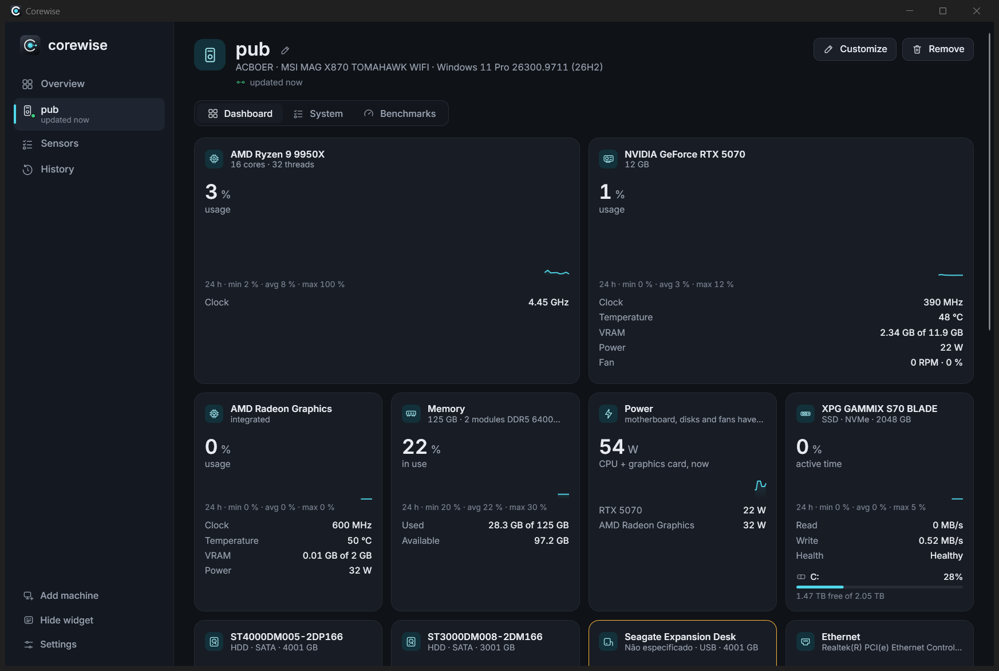
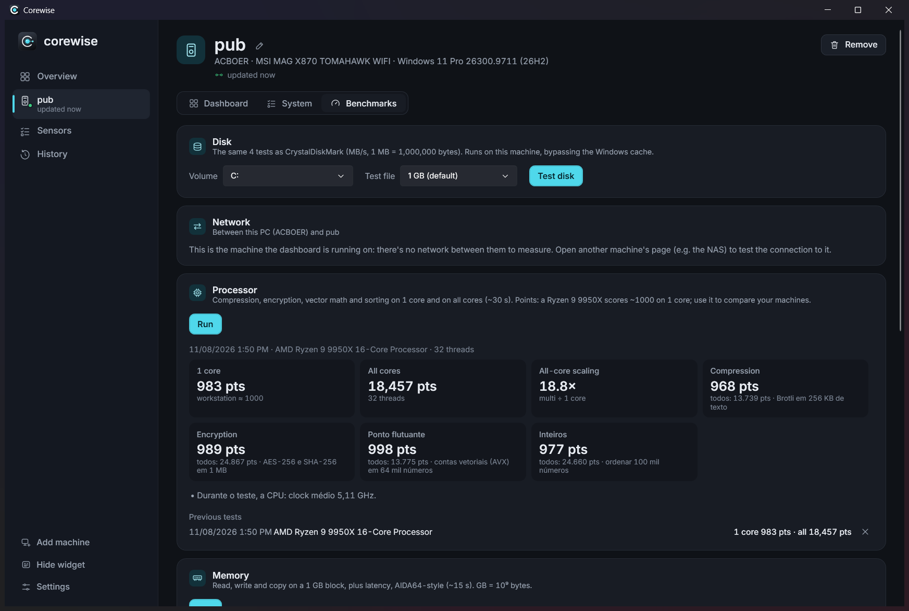
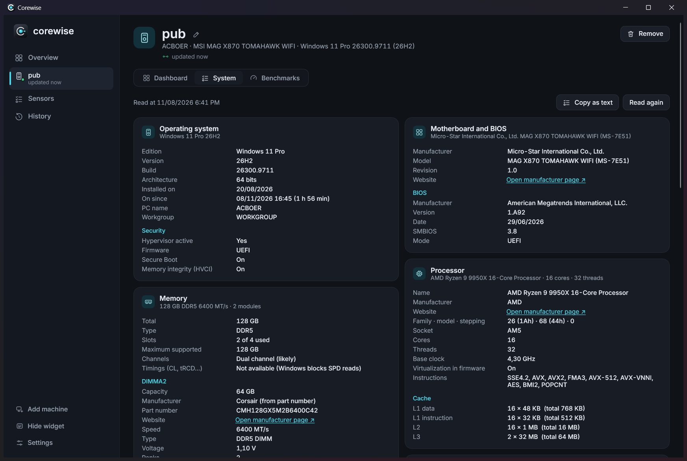

# Corewise

**Hardware monitor for all the PCs in your home or studio.** Temperatures, usage, fans, disks (SMART), network,
headset/mouse battery, in-game FPS and benchmarks, for your gaming PC, your NAS and your render nodes, in one
dashboard and an always-on-top desktop widget.

Free and open source (MIT). Windows 10/11, 64-bit. English and Portuguese.



## Features

- **Live dashboard**: CPU, GPU, RAM, disks, volumes, network, fans, power and peripherals, with 24-hour sparklines
  and alerts (yellow/red) for heat, full disks and failing drives.
- **Several machines**: install the service on each PC (gaming rig, NAS, render nodes) and watch them all from one
  dashboard. Pair a PC by clicking **Allow** on it, or with a one-time code.
- **Desktop widget**: one widget that cycles through your PCs, or one widget per PC. Compact or visual style,
  adjustable transparency, global shortcut (Ctrl+Shift+F9 by default).
- **Game mode**: FPS, 1 % low and frame-time overlay on top of full-screen games, read from Windows' own events.
  Nothing is injected into the game, so there is no anti-cheat risk. Shortcut: Ctrl+Shift+F10.
- **History**: every metric recorded for up to 2 years; game sessions with FPS, temperatures and power; daily
  usage (time on, energy, heavy load, network and disk traffic); CSV export.
- **Benchmarks**: disk (CrystalDiskMark-style), network between two PCs, CPU, memory, GPU (DirectX 11 compute) and
  a stability test with error checking and throttling detection.
- **System summary**: OS, motherboard, BIOS, CPU, RAM modules, GPUs, disks, displays and battery in one page.

| | |
|---|---|
|  |  |

## Download and install

1. Download `CorewiseSetup-<version>.exe` from [Releases](https://github.com/acboer/Corewise-Monitor/releases).
2. Choose **Full** (dashboard + service, for your own PC), **Service only** (for a PC you watch from another one:
   NAS, server, render node) or **Dashboard only**.
3. To add another PC: **Add machine**, type its name, **Find**, **Request access**, then click **Allow** on that PC.
   A PC with only the service shows a pairing code instead (Start › Corewise › Pairing code).

Silent install for many machines: `CorewiseSetup-<version>.exe /VERYSILENT /SUPPRESSMSGBOXES /TYPE=servico`.
Uninstall from Windows Settings › Apps; history stays in `C:\ProgramData\Corewise` until you delete it.

## What the installer changes on your system

- Installs the **Corewise** Windows service, running as Local System. Reading motherboard, CPU and disk sensors
  (and frame events for the FPS overlay) requires administrator rights, so the service does it and the dashboard runs
  as a normal user.
- Adds a Windows Firewall rule for **TCP 47821, private and domain networks only (never public Wi-Fi)**, so dashboards on your other PCs can reach
  the service. Traffic is HTTPS with a per-machine certificate pinned at pairing time.
- Starts the dashboard/widget with Windows (on by default; turn it off in Settings).

The uninstaller removes the service, the firewall rule and the startup entry. Your history and settings stay in
`C:\ProgramData\Corewise` and `%AppData%\Corewise` until you delete them.

## Privacy

This program will not transfer any information to other networked systems unless specifically requested by the
user. No telemetry, no accounts, no internet access: the service only answers the dashboards you pair on your own
network. Details in [PRIVACY.md](PRIVACY.md).

## Code signing policy

Releases are signed. Free code signing provided by SignPath.io, certificate by SignPath Foundation. Roles and process:
[CODE_SIGNING_POLICY.md](CODE_SIGNING_POLICY.md).

## Building from source

Requirements: Windows, [.NET 10 SDK](https://dotnet.microsoft.com/download), and
[Inno Setup 6](https://jrsoftware.org/isinfo.php) for the installer.

```powershell
dotnet build HardwareMonitor.sln
powershell -ExecutionPolicy Bypass -File instalador\gerar.ps1   # publishes and builds publish\CorewiseSetup-<version>.exe
```

| Folder | What it is |
|---|---|
| `src/HwMon.Core` | Sensors, telemetry model, benchmarks, translations (`Idiomas/en.json`) |
| `src/HwMon.Collector` | `Corewise.Service.exe`: Windows service with the HTTPS API, history and game recorder |
| `src/HwMon.Client` | API client shared by the dashboard and the CLI |
| `src/HwMon.App` | `Corewise.exe`: WPF dashboard, widget, tray icon and game overlay |
| `instalador` | Inno Setup script and build script |

The code and comments are in Portuguese; the UI is translated by putting the Portuguese text through `L.T(...)` and
adding the English line to `src/HwMon.Core/Idiomas/en.json`. Development notes (Portuguese):
[Documentação/Desenvolvimento.md](Documentação/Desenvolvimento.md).

## License

[MIT](LICENSE). Third-party components and their licenses: [THIRD-PARTY-NOTICES.md](THIRD-PARTY-NOTICES.md).
